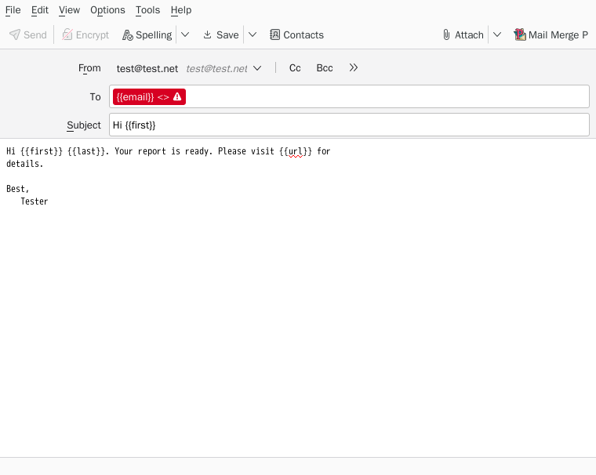
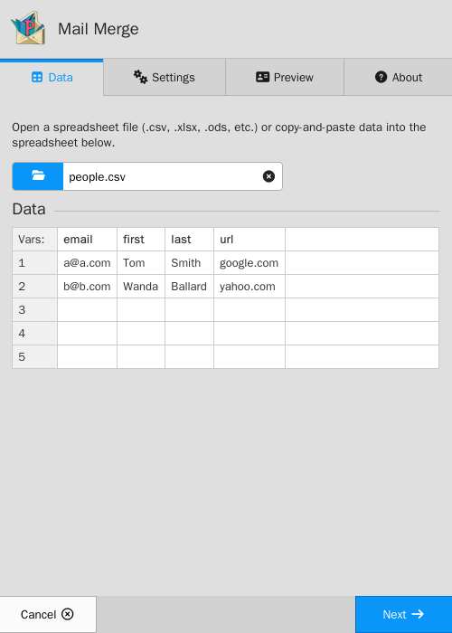
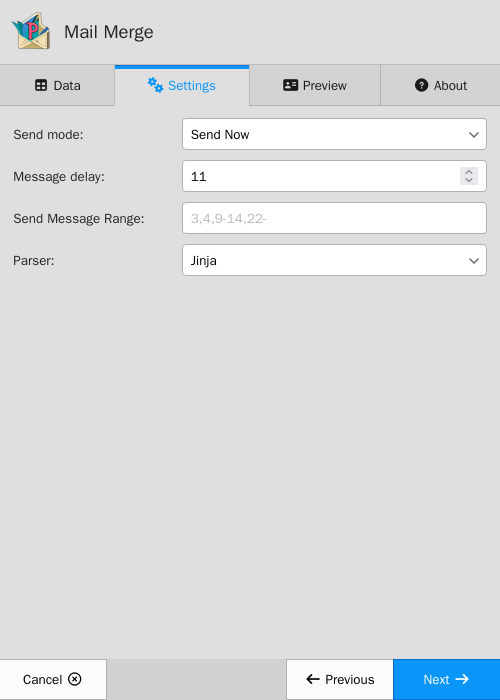
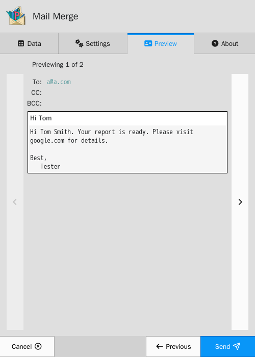

<p align="center">
    
</p>

## Mail Merge P

Mail Merge P (_Mail Merge with Preview_)
is a Thunderbird add-on to send bulk emails based off information provided in a spreadsheet.

Mail Merge P uses [Jinja](https://jinja.palletsprojects.com/en/stable/templates/) templates
(via [@huggingface/jinja](https://github.com/huggingface/huggingface.js/tree/main/packages/jinja))
to fill email templates based on data provided by a spreadsheet.

## Screenshots

Write your email in Thunderbird, with `{{...}}` where values from the spreadsheet should go, then
click **Mail Merge P**:



| Load a spreadsheet                                                                                       | Choose how to send                                                                                   | Preview each email, then send                                                                                  |
| -------------------------------------------------------------------------------------------------------- | ---------------------------------------------------------------------------------------------------- | -------------------------------------------------------------------------------------------------------------- |
|  |  |  |

## Usage

Prepare a spreadsheet with a single header row.
Any templating variable you wish to be filled, wrap in `{{..}}`. For example, if your
spreadsheet has headers `name` and `email`, you can use `{{name}}` and `{{email}}` in
the body/subject/to/cc/bcc fields of your email. Mail Merge P will then substitute data from
the spreadsheet into these fields.

You can use Jinja's conditionals, loops, filters and expressions, for example
`{{ title }} {{ last }}` or `{{ nickname | default(first) }}`. Some things
to be aware of:

-   All data from a spreadsheet is text. Use `| int` or `| float` to do arithmetic, e.g.
    `{{ amount | int + 1 }}`. Decimals are shown as `3.5` or `200.0`, and there's no way to round
    them, so keep values that need formatting (like prices) as text in the spreadsheet.
-   A variable that isn't a column in the spreadsheet is empty when used on its own (`{{ typo }}`),
    but is an error when used with a filter or operator (`{{ typo | trim }}`).
-   Columns named `true`, `false`, `none`, `range`, `namespace` and a few other names reserved by
    the template engine can't be used in templates. Rename them.
-   If an email can't be filled in, the Preview tab shows why and the emails can't be sent.

Most templates written for earlier versions of Mail Merge P, which used
[nunjucks](https://mozilla.github.io/nunjucks/), work unchanged. The exceptions are ``
blocks, the `escape`, `first`, `reverse`, `truncate` and `wordcount` filters, arithmetic on
spreadsheet values without `| int` or `| float`, and variables that aren't spreadsheet columns
used with filters or operators (nunjucks treated these as empty).

## Install

You can play around with the main ui-component in the browser: https://siefkenj.github.io/MailMergeP/browser-iframe-server.html

Mail Merge P is based off of Mail Merge by Alexander Bergmann https://addons.thunderbird.net/en-US/thunderbird/addon/mail-merge/

## Building

Building requires Node.js 22.12 or newer. To build the entire extension, first run

```sh
npm install
```

then either

```sh
npm run build-and-package
```

```sh
npm run build
npm run build-addon
npm run package-addon
```

The extension will be located in the current directory and called `mailmergep@example.net-latest.xpi`.

## Development

Mail Merge P is divided into _npm workspaces_ located in the `packages/` directory.

-   `packages/interface` the bulk of the UI code. This code runs in an iframe.
-   `packages/iframe-service` an abstraction layer so that the interface can be run in the browser or in thunderbird.
-   `packages/browser-preview` a browser-based implementation of the thunderbird API, so that the UI can be developed more quickly (with technology like hot-reloading)
-   `packages/thunderbird-iframe-service` the connection between the real thunderbird API and `iframe-service`.
-   `packages/thunderbird-extension` the actual extension's `background.js` script.

To develop the interface in the browser with hot-reloading, run

```sh
npm run dev
```

and open the URL that is printed (usually http://localhost:5173/). This serves `packages/browser-preview`
with the source of `packages/interface` loaded in its iframe.

Run the unit tests with `npm test`. `npm run test:e2e` builds the extension and runs a mail merge
in Firefox, with the same Content Security Policy that Thunderbird applies to the add-on; it fails
if anything is blocked by that policy (e.g. `eval`). The dev container installs the browser it needs;
elsewhere, run `npx playwright install --with-deps firefox` first.

`npm run test:thunderbird` builds the add-on and tests it in a real Thunderbird, running on a virtual
display and sending mail to a local test server ([Mailpit](https://mailpit.axllent.org/)), then checks
the emails that arrive. It also saves screenshots to `test-results-thunderbird/screenshots/`, including
the ones for the add-on's listing on addons.thunderbird.net. The dev container installs Thunderbird and
Mailpit (see `.devcontainer/install-thunderbird.sh`); elsewhere, set the `THUNDERBIRD` and `MAILPIT`
environment variables to their paths. CI uploads the screenshots and the packaged add-on as artifacts.

To prepare a release, run `npm run prepare-release`. It type checks, lints and runs all the tests (which
builds and packages the add-on), then copies the listing screenshots to `docs/screenshots/`, which
this README shows. `npm run screenshots` updates just those screenshots.

Most UI and backend work is handled by the html components. The `thunderbird-extension` runs the html
component in an iframe and uses message passing to communicate with the iframe.

This split means that the bulk of Mail Merge P can be developed in the browser without
Thunderbird.

To run thunderbird and force a reload of all extension content, launch thunderbird with

```
thunderbird -purgecaches
```

### Developing the HTML UI

A browser-based simulation of the Mail Merge P Thunderbird API is provided by `packages/browser-preview`.
To develop in the browser first install and build

```sh
npm install
npm run build
```

Then you can launch a dev server and open it in the browser.

```sh
cd packages/browser-preview
npx vite
```

If you want the interface code to automatically rebuild when you make a change, you can do

```sh
cd packages/interface
npx vite build --watch
```

The UI is developed using React and Redux with the helper EasyPeasy.

### Developing the Thunderbird Extension

Copy or link the contents of `thunderbird-src` to `mailmergep@example.net`
in your Thunderbird profile/extensions directory. Then restart Thunderbird and activate the
extension.

You can open the Thunderbird debugging console with Ctrl+Shift+I. Once in the debugging console,
you can manually open dialogs with the `window.open` command. For example,

    dgl = window.open("chrome://mailmergep/content/iframe-wrapper.xul", "test", "chrome")

will open and run `iframe-wrapper.xul`, which is the main UI component of Mail Merge P.
You can then poke around `dgl` for variables and functions
stored in the extension's scope.

To access the APIs available to the browser extension, you must go to the extensions
tab and click the gear icon and enable "Debug Mode". Then you can open a console
in the context of mailmergep and the `browser.*` apis will be available. To manipulate
a particular tab, you can use `browser.tabs.query({})` to get a list of all tabs and
use the `id` of the tab you want.

### Packaging

Note that a version bump must take place in `packages/thunderbird-extension/public/manifest.json`. After that, run `npm run build-and-package`.
The resulting `mailmergep@example.net-latest.xpi` is a bundle of the extension.
